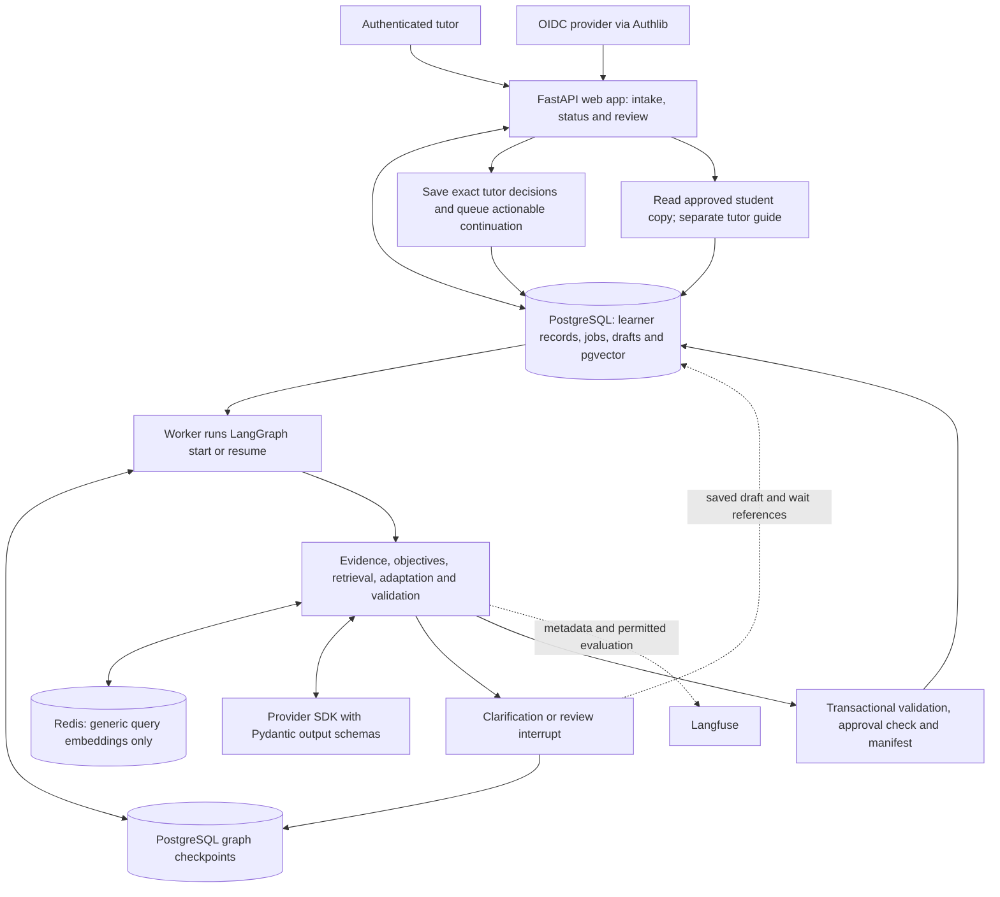
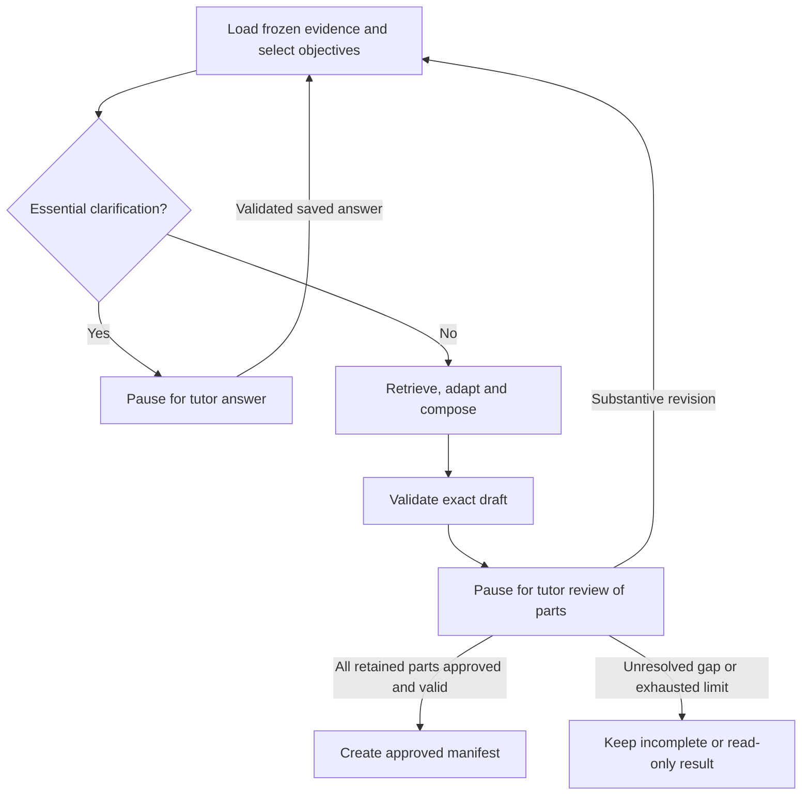

# Tutor Copilot — Architecture

Architecture study and recommendation · 1 November 2026

This document selects a proposed architecture against [Product Decisions.md](<Product Decisions.md>). The product document remains the authority for scope. Framework capabilities were checked against current official documentation, including Context7. The selections below are design judgments, not implemented features, performance results or permission to launch a pilot.

The recommendation is **one Python application, FastAPI, a separate worker running a small LangGraph workflow, PostgreSQL with pgvector and durable graph checkpoints, Redis for a small disposable cache, Pydantic schemas for model outputs, and Langfuse for evaluation**. LangGraph owns execution paths and human pauses; application records own learner facts, exact tutor decisions and approved artifacts. This revises the earlier preference for custom workflow transitions: repeated clarification, review and revision justify a pause-and-resume framework even though mid-generation recovery remains outside the pilot.

## 1. What the architecture must accomplish

The first pilot serves independent tutors preparing homework for adult A2–B2 English learners. It must complete the journey from learner evidence to checked material, tutor review and a copyable student artifact. Lesson planning, including first lessons, and urgent replanning are the next product jobs; they need equivalent coverage before activation (PD-01, PD-37).

The difficult problems are preserving the meaning of learner evidence, finding suitable teaching material, adapting it correctly, and ensuring that the tutor approves exactly what reaches the student. More agents do not solve these problems by themselves.

| Constraint | Architectural consequence |
| --- | --- |
| Accuracy, required use and appropriate non-use are separate measures | Store observations and denominators explicitly; never ask a model to maintain an unexplained mastery score. |
| Both lessons and homework change priorities | Build an evidence snapshot from both sources before selecting objectives. |
| Retrieval includes exercises, explanations and transcripts | Separate reusable teaching material from private learner evidence, even within one database. |
| Domain adaptation preserves the learning mechanism | Pass the original objective, task demands and answer criteria into adaptation; validate the result independently. |
| Tutor approves individual parts | Store immutable draft versions and explicit decisions per part. A chat message saying “looks good” is insufficient. |
| Pauses survive restarts, but mid-generation recovery is excluded | Use LangGraph interrupts with durable checkpoints for tutor waits; release the worker while waiting. A failed active generation still offers a manual new request. |
| Golden datasets cover every stage | Keep stages callable independently, with typed inputs, outputs and separate observations. This does not require services per stage. |

## 2. Teaching use cases and generation routes

### Route first by the learning problem

An embedding match answers “which material resembles this request?” It cannot determine what the learner should practise. Objective selection precedes material retrieval.

Use the following teaching routes as **proposed internal decisions within the existing product scope**. The model may suggest a route and evidence references; application rules enforce eligibility and expose uncertainty. Several routes can appear in one preparation.

| Observed need | Material to retrieve | Useful generation | What must stay visible |
| --- | --- | --- | --- |
| Missing, stale or conflicting evidence | Reviewed diagnostic or recheck activities | Compose a short recheck section and tutor observation notes | Uncertainty; this is not a placement test or mastery conclusion. |
| Attempted form is often incorrect | Material testing the exact confusion, with a reviewed explanation | Adapt the explanation, context, instructions and checked answer guide | The distinction being taught, acceptable answers and source. |
| Learner misses clear required-use opportunities | Reviewed tasks that actually elicit the relevant distinction | Adapt a supported task, then reduce prompts when appropriate | Why use was required; a valid alternative is not automatically an error. |
| Learner overuses a form | Contrastive or mixed-choice material, including inappropriate contexts | Adapt contrasts and explain accepted alternatives | Appropriate non-use; repeating only positive examples would miss the problem. |
| Skill is a maintenance candidate | Previously relevant material suitable for delayed review | Compose brief recall and transfer practice within the time budget | Tutor confirmation and evidence type; drill success does not establish spontaneous fluency. |
| Preferred domain is unavailable | A suitable reviewed asset in another context | Adapt its context, or disclose a neutral fallback for an optional preference | Required context and the learning objective cannot be silently relaxed. |

For example, an engineer may form the present perfect accurately in drills but use it where a finished-time past tense is required. Retrieve a reviewed contrastive activity, adapt it to project updates, combine it with a short source-based explanation, and provide a separate tutor key. An unrestricted “write ten engineering questions” prompt can match the domain while missing the actual learning problem.

The [Council of Europe action-oriented approach](https://www.coe.int/en/web/common-european-framework-reference-languages/action-orientation-in-the-classroom) supports meaningful communicative outcomes. [Jane Willis’s task-adaptation examples](https://www.teachingenglish.org.uk/professional-development/teachers/knowing-subject/six-types-task-tbl) illustrate how existing activities can gain clearer goals and interaction. **Design inference:** describe a task’s outcome and learner choices, not only grammar and topic tags. Neither source validates this product’s routing rules.

### Route by preparation job

| Job | Inputs and teaching emphasis | Composition and scope |
| --- | --- | --- |
| **Homework — pilot** | Selected lesson, recent lesson/homework observations, assessment, preferences and tutor requirements | Choose recheck, focused practice, transfer or maintenance sections as evidence warrants. Produce student instructions and a separate tutor key. |
| **First lesson — next stage** | Pre-lesson assessment and preferences; uncertain subskills | Retrieve diagnostic teaching activities and compose observation points. Do not invent prior performance or administer a claimed validated placement test. |
| **Ordinary lesson — next stage** | Both evidence streams, trends, ongoing goals and postponed objectives | Compose a coherent teaching sequence with explanation/support, meaningful practice and feedback where useful. Do not impose one lesson formula on every need. |
| **Urgent replan — later stage** | Tutor-confirmed event, date, goal and current learning summary | Temporarily prioritize relevant reviewed tasks, retain postponed work and request an outcome at the next preparation after the event. Do not invent employer/exam requirements or background reminders. |

The tutor explicitly selects the job. Dispatch on a validated `job_kind`; enable only `homework` in the pilot. First-lesson versus ordinary-lesson handling uses the learner's confirmed situation, not merely whether a transcript exists. An ambiguous free-text request can produce a proposed job for tutor confirmation; a model must not silently switch jobs or enable a deferred feature. Within a job, route by evidence need and then by content mode. These are ordinary conditional branches, not three different agent systems.

Delayed recall and feedback are plausible maintenance choices. [AERO’s spacing and retrieval guide](https://www.edresearch.edu.au/guides-resources/practice-guides/spacing-and-retrieval-practice-guide-full-publication) primarily addresses school teaching; applying it to adult language homework is a hypothesis to evaluate, not evidence of a learning gain here.

### Make generation useful without making it unrestricted

Use three content modes: **reuse**, **adapt a reviewed asset**, and **compose a plan from checked parts**. Explanations, transitions, instructions, tutor notes and answer guides can be generated within those boundaries. Every adapted exercise retains its reviewed source version; derived explanations identify their source material.

For each objective: search eligible material → reuse an adequate match → adapt an eligible match if necessary → validate → retain or disclose a gap. Search broadening cannot change a hard requirement. Retrieve explanations separately when the exercise needs teaching support; do not add explanation text simply to make an output longer.

**Future proposal, excluded from the pilot:** original roleplays, mock interviews, dialogues, novel diagnostic items or feedback packages unrelated to reviewed assets. These could address real content gaps, but require a product change, a separate generated-artifact provenance/status model, tutor content review and suitable gold cases. Failed retrieval must not silently enter this mode (PD-14, PD-16).

## 3. Architecture alternatives

| Architecture | Benefit | Cost or weakness | Selection |
| --- | --- | --- | --- |
| One large prompt with retrieved context | Fastest demonstration; few model calls | Mixes evidence, planning, adaptation and checking; weak error diagnosis and revision control | Use only as an evaluation baseline. |
| Fixed pipeline with conditional branches and custom saved states | Explicit inputs, bounded calls and few workflow dependencies | The application implements pause/resume transitions as well as domain records | Viable smaller alternative; not the selected execution mechanism. |
| Model-directed tool-using planner | Can explore unfamiliar material and choose actions dynamically | Harder to bound cost, permissions and teaching coverage; adds routing uncertainty | Consider only for a demonstrated task that fixed routes cannot express. |
| Supervisor with specialist agents | Can separate genuinely independent research or expertise | More calls, coordination and inconsistent state; role names do not establish expertise | Do not use for the current preparation jobs. |
| Small durable graph with explicit teaching stages | Provides persisted human pauses and clear clarification/revision paths | Adds checkpoint, replay and graph-version responsibilities alongside domain records | **Choose LangGraph for the existing tutor interaction cycle.** |

The selected graph uses explicit nodes and conditional edges, not a model-selected sequence of arbitrary tools. Models interpret language and adapt teaching content. Application code owns access, evidence windows, arithmetic and approval/export rules; LangGraph coordinates the permitted execution paths. A node can call ordinary stage functions without becoming an autonomous agent or network service.

## 4. Agent-framework selection

These choices concern orchestration and model integration, not a claim that a framework improves pedagogy.

| Option | Fit and trade-offs | Decision |
| --- | --- | --- |
| Provider SDK + Pydantic | Direct model integration with typed outputs and executable constraints. The application handles provider errors and bounded schema-repair attempts. | **Choose for calls inside graph nodes; use the provider's structured-output capability where available.** |
| PydanticAI | Typed outputs, validators, deferred approvals and optional durable integrations. It is a credible alternative for model integration, but does not replace exact document-part approval records. | Optional later if its model-call integration earns the dependency; not required alongside LangGraph initially. |
| **LangGraph** | Checkpoints and interrupts support clarification, review and revision across restarts. Replayed nodes still need safe side effects; graph persistence does not supply domain permissions or approval policy. | **Choose for orchestration and durable human pauses.** |
| CrewAI Flows / Crews | Flows support structured routing, persistence and human feedback; Crews add agent collaboration. The limitation is project fit, not an absence of workflow features. | No current need for delegated agent roles or another workflow representation. |
| Retrieval frameworks such as LlamaIndex | Can reduce work for substantial ingestion/indexing requirements, but add their own retrieval abstractions. | Start with direct database retrieval; revisit when a concrete ingestion need exceeds it. |

PydanticAI documents [output validation](https://pydantic.dev/docs/ai/core-concepts/output/), [deferred tools](https://pydantic.dev/docs/ai/tools-toolsets/deferred-tools/) and [durable-engine integrations](https://pydantic.dev/docs/ai/capabilities/durable_execution/overview/). These remain real alternatives. The selected design uses ordinary Pydantic schemas and one provider integration inside LangGraph nodes; it does not require a second orchestration framework. Schema validity cannot establish answer correctness.

[LangGraph interrupts](https://docs.langchain.com/oss/python/langgraph/interrupts) and [persistence](https://docs.langchain.com/oss/python/langgraph/persistence) provide the selected pause/resume mechanism. Use `StateGraph`, explicit wait nodes and a PostgreSQL-backed `AsyncPostgresSaver`; memory-only checkpoints cannot preserve waits across restarts. Do not add a second durable orchestrator. The worker hosts the graph; no managed agent server or autonomous supervisor is required.

**Ownership:** LangGraph checkpoints record execution position and references. Relational application records govern learner evidence, constraints, validation, tutor decisions and student export. A checkpoint is neither permission nor a second editable learner profile. Persist IDs and bounded routing state, not raw transcripts, prompts or teacher keys, in the graph state and interrupt payloads.

[CrewAI Flows](https://docs.crewai.com/en/concepts/flows) are a real workflow option. Their capabilities do not justify a crew of “grammar,” “motivation” and “critic” agents for a fixed preparation task. Compare frameworks on the same gold cases, calls, failure handling, cost and review effort before changing the selection.

Configure model stages without shell, browser, arbitrary SQL, sending or approval tools. Application code performs authorized retrieval and passes a bounded context. Use a separate solver call for adapted closed-answer exercises, withholding the proposed key until comparison. It can initially use the same tested model with a separate prompt; correlated mistakes remain possible. Add another model only if evaluation shows a useful improvement.

## 5. Application and storage choices

| Choice | Recommendation | Alternative and reason to reconsider |
| --- | --- | --- |
| Application layout | One codebase with web and worker process roles | Microservices allow independent scaling but introduce network contracts and distributed recovery. No present requirement justifies them. |
| Web framework | FastAPI, Pydantic request/response schemas, server-rendered Jinja templates and small status-refresh JavaScript | Django supplies more account/admin/form machinery and is attractive if editorial/admin workflows dominate. FastAPI fits this bounded async preparation API, but authentication, sessions and CSRF protection must be integrated explicitly. |
| Authentication | Established OIDC integration through Authlib, invite-only tutor accounts, server-side sessions | Local passwords avoid an identity provider but add credential recovery and account-security work. OIDC is chosen; the provider still needs an implementation-time terms/availability check. |
| Database | PostgreSQL; relational records plus pgvector | A dedicated vector database isolates vector scaling, but duplicates ownership, synchronization and deletion paths. SQLite is useful locally, not the selected shared pilot store. |
| Cache | Redis, initially only for exact query embeddings of generic, non-sensitive teaching searches | A process-local cache has fewer moving parts but is lost on restart and not shared between workers. Redis adds operational cost; it is selected for reuse, not required for correctness. |
| Execution persistence | LangGraph PostgreSQL checkpoint tables in the same database, separate from application records | Checkpoints support execution continuity; they do not make domain writes and graph writes one atomic transaction. Reconcile them through saved transition identities and idempotent effects. |
| Queue | Queued start/resume/ingestion work in PostgreSQL, claimed by the worker | A broker/Celery becomes useful for substantial scheduling or workload isolation. The queue dispatches graph work; it does not implement a second workflow engine. |
| Upload storage | Bounded uploaded documents stored in PostgreSQL initially, with encrypted infrastructure and explicit expiry | Object storage is better for large media; the pilot has no recording/audio pipeline. Upload limits and accepted formats must be enforced before parsing. |
| Model and embedding providers | One tested generation model and one embedding model, versioned per run/index | Choose identities using the project’s gold cases and processor terms. No unmeasured price or quality winner is asserted. Avoid a universal provider abstraction or automatic fallback in the pilot. |

FastAPI documents [templates](https://fastapi.tiangolo.com/advanced/templates/) and [response background tasks](https://fastapi.tiangolo.com/tutorial/background-tasks/); the durable queue is an application design, not a BackgroundTasks guarantee. [Authlib’s FastAPI integration](https://docs.authlib.org/en/latest/oauth2/client/web/fastapi.html) supplies protocol integration, not learner-level permissions. [Django’s authentication documentation](https://docs.djangoproject.com/en/5.2/topics/auth/) supports the alternative’s account/session benefits; object-level access still needs design.

Use a maintained PostgreSQL driver and migration tool during implementation; do not write a database adapter or generic repository layer. This study selects responsibilities rather than a tested dependency lockfile. The exact compatible package versions must be locked and exercised in the implementation task.

### Minimum Redis cache

**Cache only query embeddings initially.** Revisions can repeat the same teaching search, so reuse its embedding rather than call the embedding provider again. This is a plausible saving to measure, not a demonstrated performance requirement for the pilot. Redis loss must never lose a draft or prevent a valid preparation.

| Item | Initial policy |
| --- | --- |
| Eligible input | Generic teaching-search text assembled from a controlled, non-sensitive skill/level/domain vocabulary. Free-text tutor input, private asset text, learner source text and free-form summaries bypass this cache. |
| Key and value | `qemb:{config_revision}:{sha256(exact_embedding_input)}` → query vector. The revision identifies provider/model version, embedding settings and query-format version. Store no input text or learner/tutor IDs. |
| Expiry | Set every value with a 24-hour TTL, an initial operating choice. Model/settings/format changes use a new revision; old keys expire naturally. |
| Read/write path | Read Redis; on a miss, compute the embedding and best-effort cache it with expiry. Reject malformed vectors or wrong dimensions as misses. Search current authorized PostgreSQL material on every request. |
| Failure behavior | Short cache timeouts and no request-path Redis retries; errors bypass the cache. An embedding-provider failure remains a real preparation failure, not an invented vector or success. |

Classify input eligibility before hashing; hashing private text does not make it safe to share. Cache query vectors only, not retrieved result lists: permission, review, license and content changes therefore take effect through fresh database reads. Document/asset embeddings remain in pgvector. Generated plans, validations, tutor decisions, sessions, queue state and graph checkpoints remain outside this cache.

Use `redis.asyncio` from the maintained `redis-py` client, with a bounded process-lifetime connection pool and explicit shutdown. Use a cache-only Redis instance with a memory limit, `allkeys-lru` eviction and no snapshot/AOF persistence or backups. Concurrent misses may duplicate an embedding call; do not add distributed cache locks initially. Track only hit/miss/error counts and embedding calls avoided, without query text or hashes in logs. The [async client](https://redis.io/docs/latest/develop/clients/redis-py/async/), [`SET` expiry](https://redis.io/docs/latest/commands/set/) and [eviction documentation](https://redis.io/docs/latest/develop/reference/eviction/) support these mechanisms; the scope and TTL are project choices.

## 6. The data model and retrieval boundary

These are record responsibilities, not a table or class for every phrase.

| Record | Essential information and purpose |
| --- | --- |
| Learner/profile version | Tutor ownership, alias, adult confirmation, assessment source/date/uncertainty, preferences, goals and active/deleting state. Separates reported facts from observations. |
| Evidence source | Owner/learner, lesson or homework, date, raw content, expiry and correction history. Retain a nonverbatim provenance stub after expiry. |
| Subskill observation | Source, task type, assistance level, date, confirmation status and three numerator/denominator pairs. Deduplicate observations and supersede corrections rather than double-counting them. |
| Teaching asset/version | Kind, exact subskill/confusion, level/task demands, domain, communicative outcome, response type, expected choice, answer criteria, review and license restrictions. Preserve exercise/instruction/key relationships when chunking. |
| Preparation request | Job, tutor/learner, brief, constraints, profile/evidence version references, status, question/revision counts, graph thread/version, exact pause/interrupt identity, expiry and worker lease. |
| Draft version/parts | Objectives and reasons, timed parts, provenance, separate student/tutor content, validation findings and the context needed to determine whether approval can carry forward. |
| Tutor decision / ready artifact | Actor, exact version/part, approve/reject/edit, time and idempotency key; approved manifest and student copy derived only from approved student fields. |
| Graph checkpoint / transition receipt | Execution position and bounded references, plus identities linking saved tutor actions to queued continuations. The receipt prevents a repeated resume from repeating domain effects; it does not grant access. |

**Observations are the evidence; trends are derived views.** Apply the evidence windows and provisional rules in PD-08/09 without creating another independently editable “memory” score. Expected choices in an exercise describe its design; actual learner responses or clear tutor observations establish performance denominators. Recognition, drills and spontaneous production remain distinguishable. Transcripts alone cannot establish pronunciation, prosody or listening skill.

Keep shared reviewed assets, private tutor assets and private learner evidence in separate ownership scopes. Never search a combined unfiltered pool and remove unauthorized results afterward. Authorization precedes similarity ranking. Source text, filenames and model output cannot supply the authenticated tenant identity.

For teaching retrieval, filter by permission, review/license status, asset type, target confusion and task demands; combine exact metadata/text matching with vector similarity, then check candidate suitability. Start with exact vector search over the eligible subset. [pgvector](https://github.com/pgvector/pgvector) supports exact and approximate search; approximate search with filtering has recall trade-offs. Add HNSW or a learned reranker only after measured latency or ranking failures justify it.

Retrieve private transcript excerpts only when a selected evidence question needs them; recent structured observations should cover routine prioritization. A transcript match is evidence, never a reusable exercise or an instruction to the system. Review teaching assets before indexing them as eligible; indexing itself is not approval.

## 7. Preparation flow and component contracts

The worker executes this sequence as a small LangGraph. Stage names describe node responsibilities, not a requirement to create an agent, class or service for each row. Evidence intake precedes the preparation graph; pause nodes are separate from expensive generation and side-effecting publication.

| Stage | Inputs → outputs | Who calls it, why it is separate, and failure behavior |
| --- | --- | --- |
| Ingest/confirm evidence | Authorized notes/upload → candidate observations and tutor-confirmed records | Intake calls this before preparation. Separating interpretation from planning prevents guessed facts becoming persistent evidence. Unsupported or ambiguous observations remain unconfirmed. |
| Freeze evidence | Tutor identity, learner, job and selected lesson → versioned evidence/profile references | The preparation worker loads both lesson and homework evidence. Missing assessment/permissions block real use; other gaps stay explicit. New evidence starts a new request. |
| Select objectives/routes | Snapshot and tutor constraints → objective proposals, reasons and teaching routes | The worker applies deterministic priority/eligibility rules, with typed model suggestions where interpretation helps. Conflicting essential inputs lead to a useful bundled clarification. |
| Retrieve material | Objectives/routes and authenticated scope → eligible asset versions or gaps | The worker may reuse an eligible query embedding from Redis, then searches current authorized PostgreSQL material. No candidate means adaptation of an eligible near match, a meaningful tutor choice, or a visible gap. |
| Adapt and compose | Eligible assets, objectives and duration → draft parts, student text, tutor guide and provenance | Generate only needed changes and narrative connections. Full composition makes the result coherent; typed output errors receive at most one bounded format-repair attempt. Persistent errors produce an incomplete/failed result. |
| Validate | Exact draft and context → part/plan findings | Deterministic checks plus bounded semantic/independent-solution checks. Unknown references, wrong keys and other PD-17 failures block readiness; uncertainty is not silently treated as a pass. |
| Save and wait for review | Validated or explicitly incomplete draft → immutable review version, then a checkpointed review interrupt | Save the artifact idempotently before entering a separate wait node. Record its exact interrupt identity and release the worker; no model session or live coroutine remains open. |
| Apply tutor decision | Authenticated structured decision and exact version → saved decisions and, when actionable, queued graph continuation | The web process validates and writes the decision once. The graph reads the saved decision to regenerate or finalize; a client resume payload is not authorization. |

Model prompts receive the learning objective, evidence references/qualifications, relevant asset text, output schema and applicable constraints. Do not send the whole learner history or tutor guide to every stage. Task text may quote instruction-like material, but cannot grant permissions or change validation rules.

The initial HTTP surface needs learner/profile and evidence intake, preparation creation, preparation status/review reads, structured tutor decisions and approved-copy reads. Creation returns a request ID promptly; status refresh reads persisted state. Every learner-scoped operation resolves ownership server-side. Return validation errors for malformed input, conflicts for stale decisions and explicit incomplete/failure states for preparation problems; model prose is never an HTTP authorization decision.

Use `asyncio` in the worker for bounded independent provider/retrieval checks. Respect stage dependencies: composition waits for objectives and material; approval waits for validation. The compiled graph, checkpointer, pools and model clients live for the process; database transactions, loaded state and authorization context live for an invocation/active segment. Persisted thread records survive invocations. Never share an ORM session between concurrent tasks. A bounded thread is appropriate only for blocking parsing; multiprocessing needs measured CPU work. See [Python task/cancellation guidance](https://docs.python.org/3/library/asyncio-task.html).

## 8. Durable waiting, revisions and failures

Expose these application statuses while LangGraph coordinates execution. They are domain states derived through validated transitions, not a separate custom execution engine:

```text
queued → generating → needs_input → queued
                    → review → ready
                    → incomplete
                    → failed
review → queued                 substantive revision
needs_input / review → expired  seven-day pause limit
failed / expired → new request  explicit tutor action, no carried approvals
```

An incomplete draft is saved and readable; the tutor can supply checked material or explicitly revise scope/requirements through the normal revision path. A new learner-evidence input requires a new request. Question rounds and substantive revisions keep PD-19/23’s limits; reaching a limit never permits invented inputs. Clarification fills the request brief or resolves choices; it does not silently rewrite the frozen evidence.

**Dispatch:** create the request and queued work atomically. Claim work in a short transaction, set a lease token/deadline, then release the lock before calling providers. PostgreSQL documents [`SKIP LOCKED`](https://www.postgresql.org/docs/current/sql-select.html) for queue-like consumers. Serialize start/resume invocations for each graph thread. Domain publication and transition completion commit together, conditional on the current lease, request version and active learner. Publication, tutor actions and deletion lock the learner and then the request in the same order and recheck eligibility under those locks; a snapshot-only check is insufficient.

**Checkpoint boundary:** the checkpointer's writes and the application transaction are separate, even in the same PostgreSQL database. Save transition identities and make repeated publication/finalization return the already committed result. If a saved interrupt exists but the application wait status or queue acknowledgment was not recorded, reconcile that persisted pause without generating again. An interrupted or incomplete active generation without a completed human-wait checkpoint follows the failure policy below; do not invent successful completion from a checkpoint alone.

**Crash/timeout:** keep the five-minute active-segment cap. An expired active lease becomes a visible failure, with manual restart into a new request under PD-27. A crash after a provider call can still incur model cost without a saved result; database transactions do not make external calls exactly once. Bound provider retries and all model/format-repair calls within the segment budget. Do not automatically recover an abandoned generation from an internal step.

**Tutor action:** authenticate, lock learner/request in order, check ownership, current draft version, exact pause/interrupt identity, expiry and validation state, then record the action once. Duplicate submissions return the recorded result; stale/conflicting submissions change nothing. Individual part approvals stay in PostgreSQL and cause no model call. An answer, requested regeneration or complete approved review queues one actionable continuation. The worker resumes the same graph thread with the expected interrupt ID and saved decision/transition ID through `Command(resume=...)`; it rechecks the current records rather than trusting client-supplied graph input. Late continuations cannot bypass expiry, revision, failure or deletion.

**Replay:** an interrupted LangGraph node restarts from its beginning on resume. Keep wait nodes small, with no generation or non-idempotent writes before `interrupt()`. Give effects after a pause the same duplicate protection because execution/checkpoint acknowledgment can still fail. Use explicit graph edges for repeated clarification/revision, not a growing loop of interrupts inside one node. Pin the graph version for a paused request; route existing threads to compatible code or expire them visibly before incompatible changes.

**Approval:** approve the part’s exact content and relevant objective/timing/constraint context. Full regeneration creates a new version; retain an earlier approval only when that entire relevant context is unchanged (PD-22). New requests/retries retain none. A typo/layout correction needs validation and renewed approval of the edited part. Critical validation failures cannot be waived by an approval action.

**Ready artifact:** the graph's finalize node calls the application's transaction that confirms every retained part passes its gates and has approval, creates the manifest and records completion once. Removing a part also requires the remaining plan to meet the requested time/objectives, or an explicit scope change. Student copy reads the immutable approved student fields, never a generic draft object with the teacher key hidden in the UI. Recheck access and deletion status when copying. Count the completed-preparation allowance once, transactionally, on the first ready result for a request; graph replay and revisions do not consume extra allowance.

## 9. Privacy and retention affect every component

Enforce ownership in application queries and use PostgreSQL row-level security as a second boundary, with a non-owner runtime role and transaction-scoped tutor context. [PostgreSQL documents owner/superuser bypass behavior](https://www.postgresql.org/docs/current/ddl-rowsecurity.html); simply enabling RLS is insufficient. Worker operations need the same tenant checks as web operations.

Use opaque server-side session IDs, secure cookies and CSRF protection for state-changing browser actions. Identity-provider login establishes tutor identity; it does not grant access to every learner. No model may approve access, infer consent or send student work.

Apply PD-28 across original content, parsed text, chunks, embeddings, temporary files, saved prompts and evaluations. Raw sources and embeddings expire after 30 days; avoid copying verbatim learner passages into longer-lived structured records or drafts. Keep necessary derived learning facts, with unavailable-source markers after expiry. Plans and structured records follow the 12-month inactivity policy.

Deletion immediately marks the learner unavailable and blocks worker publication, then removes active/derived content within seven days and backups within 30. Trace/evaluation records linked to that learner also need deletion. Restoring a backup must reapply deletion records before serving traffic. Provider-held copies require compatible contracted behavior; deleting a database row cannot prove their removal.

Graph persistence joins this boundary now: delete every learner-linked historical checkpoint, pending write, interrupt payload and transition reference when required, and prevent late graph work from recreating them after deletion. The worker must be stopped or fenced before final checkpoint cleanup; a late saver write needs cleanup before the active-data deletion deadline. Keep checkpoint content to IDs and bounded routing data; any accidental raw-content copy inherits the 30-day raw-source limit. Do not add a separate conversation archive or general model memory. Keep keys and credentials outside prompts, records and telemetry.

Redis has no learner-linked cache entries by design. Verify that private/sentinel text never reaches its keys, values or logs; TTL is not a substitute for this exclusion. If private content is accidentally cached, purge affected entries immediately and fix the eligibility path before re-enabling cache writes.

## 10. Evaluation, observability and model selection

Use Langfuse as the evaluation/trace system; do not introduce a second primary evaluation platform because a framework offers one. Stage boundaries support both [offline experiments](https://langfuse.com/docs/evaluation/get-started/offline) and [online checks](https://langfuse.com/docs/evaluation/get-started/online). Live outputs need criteria and feedback, not necessarily gold answers.

| Boundary | What to evaluate |
| --- | --- |
| Evidence extraction | Correct source attribution, opportunity counts, task/assistance distinction, uncertainty and correction deduplication |
| Objectives/routes | Both evidence streams, exact confusion, comparable trends, priority constraints and useful handling of missing evidence |
| Retrieval | Permission/review eligibility, exact teaching need, candidate coverage and honest gaps |
| Adaptation | Preserved learning mechanism, level, domain, solvability, accepted alternatives and provenance |
| Composition | Coherence, usable instructions, requested timing, appropriate support and student/key separation |
| Validation/review | Detection of seeded defects, stale/double resumes, approval invalidation, failed/deleted learner behavior and exact approved export |
| Complete job | Tutor active effort, first-draft usability, confirmed assignment, failures, calls, latency and total cost |

Preserve PD-34’s 12 initial homework scenarios, intermediate labels, critical-case gates, ordinary-case threshold, second review and judge-calibration limits. Per-request validation applies to every draft; the 10% semantic monitoring sample is additional. Count one initial returned draft per request for first-draft usability, excluding revision drafts. Failures and missing scores must not disappear from denominators.

Use routine metadata-only observations: stage, outcome, versions, counts, model identity, usage, latency and failure category. Choose opaque correlation IDs and no learner names/raw prompts. Disable automatic input/output capture and sanitize exception messages as well as ordinary payloads. Permitted evaluation excerpts require minimum redaction, explicit retention and learner-linked deletion; production-to-gold reuse requires the separate permission/review in PD-28. [Langfuse masking](https://langfuse.com/docs/observability/features/masking) supports filtering before export; every exporter needs its own verified protection.

**Version baseline:** the checked package release for a future Langfuse integration is [`langfuse==5.1.0`](https://pypi.org/project/langfuse/5.1.0/), released 30 October 2026. Context7 also returned older SDK material, so use version-matched API references and verify privacy behavior rather than copying old examples. No SDK compatibility or trace delivery was tested here; recheck releases before implementation.

Select the generation model using the same reviewed cases for extraction, adaptation, independent solving and composition. Start with one eligible model, stage-specific prompts and bounded context. A cheaper extraction model or stronger solver is justified only by measured quality/cost differences. Neither lower temperature nor a second agreeing model certifies teaching correctness. Pin prompt/model/schema/embedding versions so differences can be investigated.

## 11. Build order and reasons to change the design

Implement small complete blocks: authenticated learner/evidence intake; versioned asset retrieval; one checked homework graph; durable PostgreSQL checkpoint and clarification/review pauses; per-part decisions and approved export; then queue/crash reconciliation, retention/deletion and full evaluation gates before real learner use. Each block gets its actual boundary check before the next depends on it. Do not enable a real-data pilot merely because a demo generates text.

Essential implementation checks include opportunity-denominator cases, retrieval tenancy, adaptation with wrong/ambiguous keys, duration conflicts, pause/resume across a process restart, concurrent approval/revision, stale same-thread interrupts, repeated resume effects, crashes between domain/checkpoint writes, late writes after deletion, key isolation and retention across all checkpoint copies. Confirm that part approvals do not call the model and abandoned generation still requires manual restart. Check repeated-query cache reuse, TTL/config-version misses, private-input bypass, Redis outage fallback and fresh retrieval after material/access changes. Use actual PostgreSQL/API/worker/cache boundaries; model examples alone cannot prove them.

| Observed need | Change worth considering |
| --- | --- |
| Requested recovery midway through generation | Define an explicit product-policy change before enabling checkpoint recovery; LangGraph's capability does not override PD-27. |
| A model integration repeatedly duplicates provider/schema plumbing | Evaluate PydanticAI inside graph nodes without adding another workflow owner. |
| Measured retrieval latency or missing eligible results | Tune queries/indexes and ranking; consider a dedicated vector service only after identifying the bottleneck. |
| A large, varied corpus with difficult ingestion | Evaluate an ingestion/retrieval framework against the direct implementation. |
| Repeated valuable content gaps | Propose original authoring as a product change with its own review/provenance/evaluation boundary. |
| Scheduling, high queue load or workload isolation | Introduce a broker/worker framework when the PostgreSQL queue no longer meets measured needs. |
| Tutor review remains slow | Improve explanations, material quality and review interactions before adding agent roles. |

## 12. Selected architecture for this project



The graph's teaching and human-review path is:



**Choose one small LangGraph workflow with application-owned teaching and approval records.** FastAPI serves the tutor interface; the worker starts/resumes the graph using PostgreSQL checkpoints. PostgreSQL domain tables own learner evidence, draft versions, decisions, validation and approved export; pgvector retrieves eligible material and private evidence within their separate access scopes. Redis reuses generic query embeddings and can be bypassed without losing state. Model nodes use one provider integration and Pydantic schemas. Langfuse remains the evaluation system.

The pilot generates value by selecting the right teaching response, adapting reviewed materials and composing usable homework. It retains tutor approval, explicit gaps and manual handoff. LangGraph handles the repeated human pauses without introducing agent crews or model-owned approval. Redis is the sole additional cache; PydanticAI, a broker, another vector store and unrestricted authoring are not initial dependencies. This is the revised design to implement next, not a claim that the application exists.
