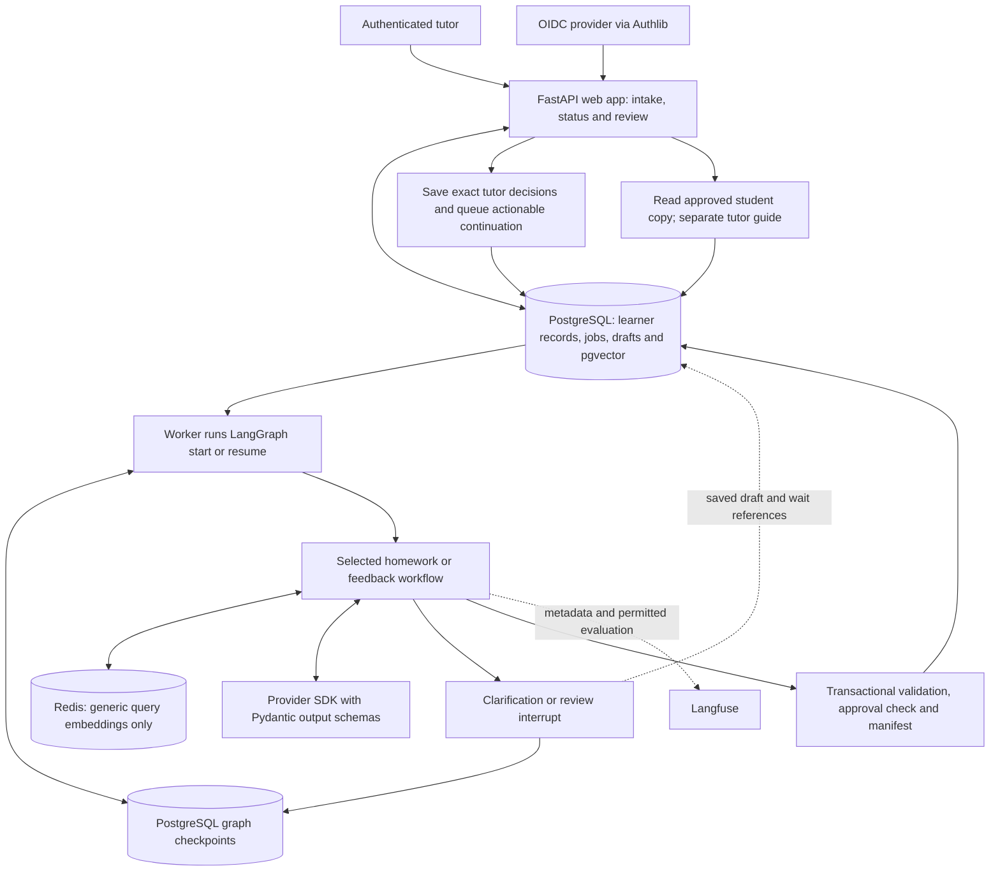
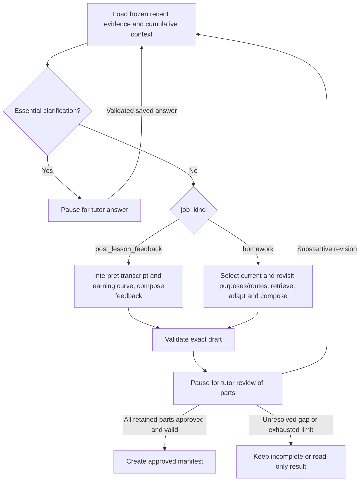

# Tutor Copilot — Architecture

Architecture study and recommendation · 1 November 2026

This document selects a proposed architecture against [Product Decisions.md](<Product Decisions.md>). The product document remains the authority for scope. Framework capabilities were checked against current official documentation, including Context7. The selections below are design judgments, not implemented features, performance results or permission to launch a pilot.

The recommendation is **one Python application, FastAPI, a separate worker running a small LangGraph workflow, PostgreSQL with pgvector and durable graph checkpoints, Redis for a small disposable cache, Pydantic schemas for model outputs, and Langfuse for evaluation**. LangGraph owns execution paths and human pauses; application records own learner facts, exact tutor decisions and approved artifacts. This revises the earlier preference for custom workflow transitions: repeated clarification, review and revision justify a pause-and-resume framework even though mid-generation recovery remains outside the pilot.

## 1. What the architecture must accomplish

The first pilot serves independent tutors preparing homework for adult A2–B2 English learners. Post-lesson feedback is the next major job, before lesson planning (including first lessons) and urgent replanning. Each needs its own checked journey through tutor review and a copyable approved artifact before activation (PD-01/37/38). This is delivery order; a feedback request does not require a prior homework request.

The difficult problems are preserving the meaning of learner evidence, finding suitable teaching material, adapting it correctly, and ensuring that the tutor approves exactly what reaches the student. More agents do not solve these problems by themselves.

| Constraint | Architectural consequence |
| --- | --- |
| Accuracy, required use and appropriate non-use are separate measures | Store observations and denominators explicitly; never ask a model to maintain an unexplained mastery score. |
| Recent performance and cumulative learning history both inform teaching | Freeze both evidence streams plus relevant source-qualified activity facts; keep the recent PD-08/09 window separate from cumulative context (PD-39). |
| Teaching is not restricted to correcting visible errors | Select a purpose/outcome and route from goals and evidence; allow input, vocabulary, fluency, discourse, strategy and task/project work without an invented confusion (PD-40). |
| Feedback uses the transcript and the learning curve so far | Freeze the selected authorized transcript and source-linked learner state; compute qualified comparisons from saved observations before generating feedback. Approval never writes performance observations. |
| Retrieval includes exercises, explanations and transcripts | Separate reusable teaching material from private learner evidence, even within one database. |
| Domain adaptation preserves the learning mechanism | Pass the original objective, task demands and answer criteria into adaptation; validate the result independently. |
| Tutor approves individual parts | Store immutable draft versions and explicit decisions per part. A chat message saying “looks good” is insufficient. |
| Pauses survive restarts, but mid-generation recovery is excluded | Use LangGraph interrupts with durable checkpoints for tutor waits; release the worker while waiting. A failed active generation still offers a manual new request. |
| Golden datasets cover every stage | Keep stages callable independently, with typed inputs, outputs and separate observations. This does not require services per stage. |

## 2. Teaching use cases and generation routes

### Route first by the learning problem

An embedding match answers “which material resembles this request?” It cannot determine what the learner should learn or revisit. Goals, recent performance and cumulative context inform objective selection before material retrieval.

Use the following teaching routes as **proposed internal decisions within the existing product scope**. The model may suggest a route and evidence references; application rules enforce eligibility and expose uncertainty. Several routes can appear in one preparation.

| Observed need | Material to retrieve | Useful generation | What must stay visible |
| --- | --- | --- | --- |
| Missing, stale or conflicting evidence | Reviewed diagnostic or recheck activities | Compose a short recheck section and tutor observation notes | Uncertainty; this is not a placement test or mastery conclusion. |
| Attempted form is often incorrect | Material testing the exact confusion, with a reviewed explanation | Adapt the explanation, context, instructions and checked answer guide | The distinction being taught, acceptable answers and source. |
| Learner misses clear required-use opportunities | Reviewed tasks that actually elicit the relevant distinction | Adapt a supported task, then reduce prompts when appropriate | Why use was required; a valid alternative is not automatically an error. |
| Learner overuses a form | Contrastive or mixed-choice material, including inappropriate contexts | Adapt contrasts and explain accepted alternatives | Appropriate non-use; repeating only positive examples would miss the problem. |
| Skill is a maintenance candidate | Previously relevant material suitable for delayed review | Compose brief recall and transfer practice within the time budget | Tutor confirmation and evidence type; drill success does not establish spontaneous fluency. |
| Prior work is relevant but later retention/transfer is uncertain | Reviewed recall, recheck or varied-context tasks | Adapt a proportionate revisit section | History/date/reason; elapsed time alone proves no forgetting and exposure proves no mastery. |
| A goal needs accessible reading/listening input | Reviewed texts or available permitted recordings with support and criteria | Adapt surrounding instructions/support without falsifying source content or recording correspondence | Input demands, prior-knowledge uncertainty and actual source; assigning input proves no comprehension. |
| A goal needs vocabulary exposure | Reviewed contextualized vocabulary/input activities | Adapt useful encounters and meaningful follow-up where warranted | Exposure versus observed use/recall; no invented vocabulary deficit. |
| Familiar language needs more fluent use | Reviewed practice with clear communicative purpose and manageable demands | Adapt rehearsal/repetition and support reduction | Assistance/task conditions and suitable fluency criteria; drill accuracy alone is insufficient. |
| A goal needs discourse models | Reviewed examples of the relevant genre or interaction | Compose source-based noticing/comparison and supported application | Organization, audience and communicative purpose, not just grammar/topic overlap. |
| A goal needs communication strategies | Reviewed clarification, repair, paraphrasing or interaction tasks | Adapt purposeful strategy rehearsal | Appropriate strategy choice and task outcome; a particular form is not mandatory when alternatives work. |
| A goal needs an integrated task/project | A reviewed task/project framework with inputs, steps and outcome criteria | Adapt the framework and scaffolding within scope/time | Task demands, feasible support and criteria; no unrelated original project authoring. |
| Preferred domain is unavailable | A suitable reviewed asset in another context | Adapt its context, or disclose a neutral fallback for an optional preference | Required context and the learning objective cannot be silently relaxed. |

For example, an engineer may form the present perfect accurately in drills but use it where a finished-time past tense is required. Retrieve a reviewed contrastive activity, adapt it to project updates, combine it with a short source-based explanation, and provide a separate tutor key. An unrestricted “write ten engineering questions” prompt can match the domain while missing the actual learning problem.

### Select current work and worthwhile review

On each tutor request, load relevant retained activity facts alongside recent lesson/homework observations and current goals. Select explained **important-now**, **worth-revisiting**, or combined objectives under PD-10/39; do not impose a fixed split. A revisit may use prior encountered/attempted/checked material, elapsed time, current relevance and uncertainty. Assignment-only history establishes neither exposure nor forgetting. Check an uncertain prerequisite only when useful; otherwise use appropriate support or a lighter reviewed task. Do not infer prerequisite mastery from earlier exposure or build a prerequisite graph.

An objective carries teaching purpose, target outcome, route, applicable skill tags/optional confusion, demands/support, material kind/modality, outcome criteria, priority category and goal/evidence/history reason references. A remediation route requires its actual confusion; a goal-led input or project route need not invent one. These are fields in the existing typed objective/search contracts, not new agent roles. Suitable input and route-specific criteria are required even when no error is observed. No route is compulsory in every draft.

The [Council of Europe action-oriented approach](https://www.coe.int/en/web/common-european-framework-reference-languages/action-orientation-in-the-classroom) supports meaningful communicative outcomes. [Jane Willis’s task-adaptation examples](https://www.teachingenglish.org.uk/professional-development/teachers/knowing-subject/six-types-task-tbl) illustrate how existing activities can gain clearer goals and interaction. **Design inference:** describe a task’s outcome and learner choices, not only grammar and topic tags. Neither source validates this product’s routing rules.

### Route by preparation job

| Job | Inputs and teaching emphasis | Composition and scope |
| --- | --- | --- |
| **Homework — pilot** | Selected lesson, recent lesson/homework observations, qualified cumulative history, assessment, goals/preferences and tutor requirements | Balance current learning and worthwhile review; choose PD-40 input/practice/task routes as warranted. Produce student instructions and a separate tutor key/criteria. |
| **Post-lesson feedback — next stage** | Selected authorized transcript, confirmed observations/state, comparable recent rates/trends, relevant cumulative context, goals and tutor constraints | Compose supported findings/comparisons and suggestions. Separate student sections/private notes; history adds context, not fabricated progress or automatic history/metric updates. No exercise or duration requirement. |
| **First lesson — after feedback** | Pre-lesson assessment and preferences; uncertain subskills | Retrieve diagnostic teaching activities and compose observation points. Do not invent prior performance or administer a claimed validated placement test. |
| **Ordinary lesson — after feedback** | Both evidence streams, cumulative context, trends, ongoing goals and postponed objectives | Compose a coherent sequence of accessible input, support, focused/meaningful practice and feedback as useful. Do not impose one lesson formula on every need. |
| **Urgent replan — later stage** | Tutor-confirmed event, date, goal and current learning summary | Temporarily prioritize relevant reviewed tasks, retain postponed work and request an outcome at the next preparation after the event. Do not invent employer/exam requirements or background reminders. |

The tutor explicitly selects the job. Dispatch on validated `job_kind`: `homework` first, then `post_lesson_feedback` when its checks pass; lesson/replan routes remain disabled. First-lesson versus ordinary-lesson handling uses the learner's confirmed situation, not merely whether a transcript exists. An ambiguous request can propose a job for tutor confirmation; a model must not silently switch jobs or enable a deferred feature. These are conditional branches in the same application and LangGraph, not separate agent systems.

### Post-lesson feedback path

Authorize the selected transcript and learner → freeze transcript/profile/observation and relevant activity-history revisions → compute recent rates/comparisons and separate cumulative context → select supported findings → compose feedback sections and private tutor notes → validate → persist the exact draft → pause for tutor review → export approved student fields. The latest lesson is the default; selecting another lesson changes the request context. Missing or expired current transcript makes the request incomplete; notes and saved summaries cannot silently replace it or reconstruct quotes.

Saved learner state means confirmed observations, assessment/preferences, source-qualified activity facts and derived PD-08/09/39 views. The learning curve remains a qualified recent-performance comparison, not model-maintained memory: retain separate measures, task/assistance distinctions, counts, dates and mixed/insufficient status. Cumulative encounters or older checks supply context without entering recent denominators or establishing progress. New transcript interpretations remain candidates until separately confirmed. Generating, approving, regenerating or exporting feedback cannot create activity facts/observations, recount a transcript or change mastery/trends. Correcting evidence starts a new request; wording revisions reuse the frozen snapshot.

Use `HomeworkDraft` and `FeedbackDraft` as job-specific output schemas with shared version/part-review records. Homework claims material provenance and timings; feedback claims transcript/observation references and explicitly marked suggestions. Validate them by job. Feedback may retrieve authorized source excerpts and optional reviewed explanations; it does not require exercise retrieval, domain adaptation, closed-answer solving or a fictitious exercise ID. Check that a suggested next step is not presented as assigned homework or a confirmed learner fact. Private tutor notes never enter the student serializer.

Delayed recall and feedback are plausible maintenance choices. [AERO’s spacing and retrieval guide](https://www.edresearch.edu.au/guides-resources/practice-guides/spacing-and-retrieval-practice-guide-full-publication) primarily addresses school teaching; applying it to adult language homework is a hypothesis to evaluate, not evidence of a learning gain here.

### Make generation useful without making it unrestricted

For teaching plans, use **reuse**, **adapt a reviewed asset**, and **compose a plan from checked parts**. Explanations, transitions, instructions, tutor notes and answer guides can be generated within those boundaries. Every adapted exercise retains its reviewed source version; derived explanations identify their source material. Feedback is a separate adopted composition mode grounded in learner evidence (PD-38), with claim provenance rather than an invented teaching-asset reference.

For each objective: search eligible material → reuse an adequate match → adapt an eligible match if necessary → validate purpose, accessibility and route-specific criteria → retain or disclose a gap. Reviewed reading/listening input and task/project frameworks use the same source boundary. Search broadening cannot change a hard requirement. Retrieve explanations only when teaching support is useful; do not add explanations or error-remediation sections simply to make an output longer.

**Future proposal, excluded from the pilot:** unrelated original exercises, roleplays, mock interviews, dialogues or novel diagnostic items. These could address content gaps, but require a product change, content provenance/review and suitable gold cases. Failed retrieval must not silently enter this mode (PD-14/16). Evidence-grounded post-lesson feedback is now explicitly in scope; invented learner histories and assessments remain prohibited.

## 3. Architecture alternatives

| Architecture | Benefit | Cost or weakness | Selection |
| --- | --- | --- | --- |
| One large prompt with retrieved context | Fastest demonstration; few model calls | Mixes evidence, planning, adaptation and checking; weak error diagnosis and revision control | Use only as an evaluation baseline. |
| Fixed pipeline with conditional branches and custom saved states | Explicit inputs, bounded calls and few workflow dependencies | The application implements pause/resume transitions as well as domain records | Viable smaller alternative; not the selected execution mechanism. |
| Model-directed tool-using planner | Can explore unfamiliar material and choose actions dynamically | Harder to bound cost, permissions and teaching coverage; adds routing uncertainty | Consider only for a demonstrated task that fixed routes cannot express. |
| Supervisor with specialist agents | Can separate genuinely independent research or expertise | More calls, coordination and inconsistent state; role names do not establish expertise | Do not use for the current preparation jobs. |
| Small durable graph with explicit teaching stages | Provides persisted human pauses and clear clarification/revision paths | Adds checkpoint, replay and graph-version responsibilities alongside domain records | **Choose LangGraph for the existing tutor interaction cycle.** |

The selected graph uses explicit nodes and conditional edges, not a model-selected sequence of arbitrary tools. Models interpret language and adapt teaching content. Application code owns access, evidence windows, arithmetic and approval/export rules; LangGraph coordinates the permitted execution paths. A node can call ordinary stage functions without becoming an autonomous agent or network service.

## 4. Agent-framework selection

These choices concern orchestration and model integration, not a claim that a framework improves pedagogy.

| Option | Fit and trade-offs | Decision |
| --- | --- | --- |
| Provider SDK + Pydantic | Direct model integration with typed outputs and executable constraints. The application handles provider errors and bounded schema-repair attempts. | **Choose for calls inside graph nodes; use the provider's structured-output capability where available.** |
| PydanticAI | Typed outputs, validators, deferred approvals and optional durable integrations. It is a credible alternative for model integration, but does not replace exact document-part approval records. | Optional later if its model-call integration earns the dependency; not required alongside LangGraph initially. |
| **LangGraph** | Checkpoints and interrupts support clarification, review and revision across restarts. Replayed nodes still need safe side effects; graph persistence does not supply domain permissions or approval policy. | **Choose for orchestration and durable human pauses.** |
| CrewAI Flows / Crews | Flows support structured routing, persistence and human feedback; Crews add agent collaboration. The limitation is project fit, not an absence of workflow features. | No current need for delegated agent roles or another workflow representation. |
| Retrieval frameworks such as LlamaIndex | Can reduce work for substantial ingestion/indexing requirements, but add their own retrieval abstractions. | Start with direct database retrieval; revisit when a concrete ingestion need exceeds it. |

PydanticAI documents [output validation](https://pydantic.dev/docs/ai/core-concepts/output/), [deferred tools](https://pydantic.dev/docs/ai/tools-toolsets/deferred-tools/) and [durable-engine integrations](https://pydantic.dev/docs/ai/capabilities/durable_execution/overview/). These remain real alternatives. The selected design uses ordinary Pydantic schemas and one provider integration inside LangGraph nodes; it does not require a second orchestration framework. Schema validity cannot establish answer correctness.

[LangGraph interrupts](https://docs.langchain.com/oss/python/langgraph/interrupts) and [persistence](https://docs.langchain.com/oss/python/langgraph/persistence) provide the selected pause/resume mechanism. Use `StateGraph`, explicit wait nodes and a PostgreSQL-backed `AsyncPostgresSaver`; memory-only checkpoints cannot preserve waits across restarts. Do not add a second durable orchestrator. The worker hosts the graph; no managed agent server or autonomous supervisor is required.

**Ownership:** LangGraph checkpoints record execution position and references. Relational application records govern learner evidence, constraints, validation, tutor decisions and student export. A checkpoint is neither permission nor a second editable learner profile. Persist IDs and bounded routing state, not raw transcripts, prompts or teacher keys, in the graph state and interrupt payloads.

[CrewAI Flows](https://docs.crewai.com/en/concepts/flows) are a real workflow option. Their capabilities do not justify a crew of “grammar,” “motivation” and “critic” agents for a fixed preparation task. Compare frameworks on the same gold cases, calls, failure handling, cost and review effort before changing the selection.

Configure model stages without shell, browser, arbitrary SQL, sending or approval tools. Application code performs authorized retrieval and passes a bounded context. Use a separate solver call for adapted closed-answer exercises, withholding the proposed key until comparison. It can initially use the same tested model with a separate prompt; correlated mistakes remain possible. Add another model only if evaluation shows a useful improvement.

## 5. Application and storage choices

| Choice | Recommendation | Alternative and reason to reconsider |
| --- | --- | --- |
| Application layout | One codebase with web and worker process roles | Microservices allow independent scaling but introduce network contracts and distributed recovery. No present requirement justifies them. |
| Web framework | FastAPI, Pydantic request/response schemas, server-rendered Jinja templates and small status-refresh JavaScript | Django supplies more account/admin/form machinery and is attractive if editorial/admin workflows dominate. FastAPI fits this bounded async preparation API, but authentication, sessions and CSRF protection must be integrated explicitly. |
| Authentication | Established OIDC integration through Authlib, invite-only tutor accounts, server-side sessions | Local passwords avoid an identity provider but add credential recovery and account-security work. OIDC is chosen; the provider still needs an implementation-time terms/availability check. |
| Database | PostgreSQL; relational records plus pgvector | A dedicated vector database isolates vector scaling, but duplicates ownership, synchronization and deletion paths. SQLite is useful locally, not the selected shared pilot store. |
| Cache | Redis, initially only for exact query embeddings of generic, non-sensitive teaching searches | A process-local cache has fewer moving parts but is lost on restart and not shared between workers. Redis adds operational cost; it is selected for reuse, not required for correctness. |
| Execution persistence | LangGraph PostgreSQL checkpoint tables in the same database, separate from application records | Checkpoints support execution continuity; they do not make domain writes and graph writes one atomic transaction. Reconcile them through saved transition identities and idempotent effects. |
| Queue | Queued start/resume/ingestion work in PostgreSQL, claimed by the worker | A broker/Celery becomes useful for substantial scheduling or workload isolation. The queue dispatches graph work; it does not implement a second workflow engine. |
| Upload storage | Bounded uploaded documents stored in PostgreSQL initially, with encrypted infrastructure and explicit expiry | Object storage is better for large media; the pilot has no learner-recording/audio-assessment pipeline. Reviewed listening uses available permitted teaching-material references. Enforce upload limits and formats before parsing. |
| Model and embedding providers | One tested generation model and one embedding model, versioned per run/index | Choose identities using the project’s gold cases and processor terms. No unmeasured price or quality winner is asserted. Avoid a universal provider abstraction or automatic fallback in the pilot. |

FastAPI documents [templates](https://fastapi.tiangolo.com/advanced/templates/) and [response background tasks](https://fastapi.tiangolo.com/tutorial/background-tasks/); the durable queue is an application design, not a BackgroundTasks guarantee. [Authlib’s FastAPI integration](https://docs.authlib.org/en/latest/oauth2/client/web/fastapi.html) supplies protocol integration, not learner-level permissions. [Django’s authentication documentation](https://docs.djangoproject.com/en/5.2/topics/auth/) supports the alternative’s account/session benefits; object-level access still needs design.

Use a maintained PostgreSQL driver and migration tool during implementation; do not write a database adapter or generic repository layer. This study selects responsibilities rather than a tested dependency lockfile. The exact compatible package versions must be locked and exercised in the implementation task.

### Minimum Redis cache

**Cache only query embeddings initially.** Revisions can repeat the same teaching search, so reuse its embedding rather than call the embedding provider again. This is a plausible saving to measure, not a demonstrated performance requirement for the pilot. Redis loss must never lose a draft or prevent a valid preparation.

Here, a query is the application-built teaching-search description defined in section 6. It is not the tutor's entire request, a SQL statement or a learner transcript. Asset embeddings are created during ingestion and stored with asset versions; a query embedding represents the current search description in the compatible vector space. Direct learner-record loading and metric calculation do not use this cache.

| Item | Initial policy |
| --- | --- |
| Eligible input | Generic teaching-search text assembled from a controlled, non-sensitive skill/level/domain vocabulary. Free-text tutor input, private asset text, learner source text and free-form summaries bypass this cache. |
| Key and value | `qemb:{config_revision}:{sha256(exact_embedding_input)}` → query vector. The revision identifies provider/model version, embedding settings and query-format version. Store no input text or learner/tutor IDs. |
| Expiry | Set every value with a 24-hour TTL, an initial operating choice. Model/settings/format changes use a new revision; old keys expire naturally. |
| Read/write path | Read Redis; on a miss, compute the embedding and best-effort cache it with expiry. Reject malformed vectors or wrong dimensions as misses. Search current authorized PostgreSQL material on every request. |
| Failure behavior | Short cache timeouts and no request-path Redis retries; errors bypass the cache. An embedding-provider failure remains a real preparation failure, not an invented vector or success. |

Classify input eligibility before hashing; hashing private text does not make it safe to share. Cache query vectors only, not retrieved result lists: permission, review, license and content changes therefore take effect through fresh database reads. Document/asset embeddings remain in pgvector. Generated plans, validations, tutor decisions, sessions, queue state and graph checkpoints remain outside this cache.

Use `redis.asyncio` from the maintained `redis-py` client, with a bounded process-lifetime connection pool and explicit shutdown. Use a cache-only Redis instance with a memory limit, `allkeys-lru` eviction and no snapshot/AOF persistence or backups. Concurrent misses may duplicate an embedding call; do not add distributed cache locks initially. Track only hit/miss/error counts and embedding calls avoided, without query text or hashes in logs. The [async client](https://redis.io/docs/latest/develop/clients/redis-py/async/), [`SET` expiry](https://redis.io/docs/latest/commands/set/) and [eviction documentation](https://redis.io/docs/latest/develop/reference/eviction/) support these mechanisms; the scope and TTL are project choices.

## 6. The data model and retrieval boundary

These are record responsibilities, not a table or class for every phrase.

| Record | Essential information and purpose |
| --- | --- |
| Learner/profile version | Tutor ownership, alias, adult confirmation, assessment source/date/uncertainty, preferences, goals and active/deleting state. Separates reported facts from observations. |
| Evidence source | Owner/learner, lesson/homework or tutor actual-use report, date/unknown qualification, raw content, expiry and correction history. Retain a nonverbatim provenance stub after expiry. |
| Subskill observation | Source, task type, assistance level, date, confirmation status and three numerator/denominator pairs. Deduplicate observations and supersede corrections rather than double-counting them. |
| Learning activity facts | Tutor/learner ownership; activity/material/task reference and purpose; separately dated assignment, encounter, attempt or checked-outcome facts, source/confirmation, context and assistance where known. Link existing sources/observations rather than duplicating performance. These are independent facts, not mandatory sequential statuses. |
| Teaching asset/version | Kind, teaching purpose/target outcome, applicable skills/optional confusion, level/task/prior-knowledge demands, domain, modality/length, support, response type and answer/outcome criteria, review and license restrictions. Preserve content/instruction/key relationships; listening records identify an available permitted recording and matching reviewed criteria. |
| Preparation request | Job, tutor/learner, brief, constraints, profile/evidence/activity-fact version references, status, question/revision counts, graph thread/version, exact pause/interrupt identity, expiry and worker lease. |
| Draft version/parts | Job-specific content: homework objectives/timed parts or feedback sections/evidence-linked findings; separate student/tutor fields, validation and the context governing approval carryover. Feedback references existing evidence; it is not a new observation record. |
| Tutor decision / ready artifact | Actor, exact version/part, approve/reject/edit, time and idempotency key; approved manifest and student copy derived only from approved student fields. |
| Graph checkpoint / transition receipt | Execution position and bounded references, plus identities linking saved tutor actions to queued continuations. The receipt prevents a repeated resume from repeating domain effects; it does not grant access. |

**Performance observations govern rates; activity facts supply cumulative context.** Recent trends and cumulative summaries are derived views, never independently editable model memory. Apply PD-08/09 windows/rules only to comparable confirmed performance. A draft/approval/export records planned content only; the tutor separately confirms assignment or supplies actual encounter/attempt/check evidence through intake. Reading/listening may be encountered without an output attempt. A checked answer does not prove encounter with every assigned item. Correct/supersede facts and deduplicate source/activity/attempt references; do not turn one response into two opportunities through different imports. Missing dates/amounts remain unknown. Expected choices describe task design; actual responses or clear observations establish denominators. Recognition, drills and spontaneous production remain distinct. Transcripts alone establish no pronunciation, prosody or listening skill.

For feedback, version the selected transcript, observations and relevant activity-fact references with the draft. Keep candidate findings distinct from confirmed records; enforce no activity-history/performance writes in feedback generation/review/export, including retries/finalization. Ordinary draft review/export has the same separation from activity intake. Reuse relational records with a job discriminator; do not add a memory database, feedback vector store or generic event/artifact framework.

Keep shared reviewed assets, private tutor assets and private learner evidence in separate ownership scopes. Never search a combined unfiltered pool and remove unauthorized results afterward. Authorization precedes similarity ranking. Source text, filenames and model output cannot supply the authenticated tenant identity.

### Load known learner records directly

The worker loads the selected transcript by its authorized source/version reference and confirmed observations by learner, date, subskill and task/assistance context under PD-08/09. Database selection establishes the recent evidence window; deterministic calculations produce counts, rates and qualified comparisons. Separately load retained activity facts relevant to current goals, skills/purposes and prior material/context under PD-39, including facts outside 90 days. Derive a bounded cumulative view with dates, source qualifications, prior encounters/practice/checks and unknowns; keep references/coverage explicit rather than sending all raw history to the model. This view informs current/revisit choices, never recent denominators or a predicted forgetting/mastery score. A similarity score must not select which observations enter a rate or trend.

Post-lesson feedback uses this path before interpretation/composition. Cover the selected transcript; if it exceeds a model context limit, process source-linked segments with explicit coverage and combine supported findings. Taking only the top few similar passages could hide contradictory evidence and cannot establish lesson coverage. Preserve uncertainty, attribution and unavailable-source markers. Missing/expired current transcript still stops feedback; other records do not replace it.

A private semantic search is optional for a specific question such as finding earlier examples of a particular confusion. Restrict it to authorized, available learner sources and retain exact references. Its matches supplement the question's context; they do not substitute for required source coverage or confirmed history. A transcript match remains evidence, never a teaching asset or an instruction to the system.

### Construct and execute a teaching-material search

The preparation graph calls application functions in `retrieval.py`; no autonomous search agent or model-written SQL is needed. The initial sequence is selected objective → structured search fields → application-built description and filters → embedding → eligible asset candidates → suitability checks.

| Step and caller | Inputs → outputs | Responsibility and failure boundary |
| --- | --- | --- |
| Select an objective, in the homework/lesson branch | Frozen recent evidence, cumulative context, goals and requirements → purpose/outcome, route, applicable skills/optional confusion, priority category, level/task demands, modality/support/criteria, domain constraints and reason references | Rules own arithmetic/eligibility. The LLM may propose a teaching response; validate goal/evidence/history support and constraints. No-error goals are valid; remediation needs its actual confusion. Essential gaps stay incomplete or need useful clarification. |
| Build the search, called by that branch | Selected objective and authenticated scope → search description, separate filters and objective reference | Application code formats controlled, non-sensitive teaching terms into a versioned template. Keep learner IDs, quotations and private summaries out of the embedding text. Authenticated scope comes from server state, never model output. |
| Search the teaching bank, called by the worker | Validated description/filters → candidate asset IDs/versions, permitted content, teaching metadata and source/rights references, or an explicit gap | Reuse an eligible cached query vector or call the embedding model; execute parameterized database queries. Enforce permission/review/license eligibility before ranking, then check objective/task fit. A close vector match is not approval. |

For example, high form accuracy with inappropriate present-perfect use may select **contrastive choice practice**, not more positive present-perfect examples. The formatted search text could be: “Choose present perfect or past simple, including contexts where present perfect is inappropriate; contrastive practice for project updates.” Separate fields carry B1 task demands, exercise/explanation type, required constraints and whether the project-update domain is preferred or required. Evidence references link the objective to the learner without entering the search text. Search an explanation separately only when it is needed.

A goal-led search may instead request “accessible B1 incident-report models; identify report structure and explain the main implications,” with reading modality, language/prior-knowledge demands, support and outcome criteria, and no fabricated grammar confusion. Use controlled generic fields for shared search; private goal wording/history still stays out of cached embedding input. For listening, validate the actual recording's availability, permitted use and criterion/key correspondence before retaining material. A transcript-only or inaccessible recording is a material gap, not completed listening practice; no learner audio scoring is implied.

Keep hard restrictions separate from ranking preferences. Domain similarity cannot override the target confusion, rights or access. An eligible near match may enter the existing checked adaptation path; it is not permission to silently relax a requirement. Return a content gap when nothing eligible can satisfy it. An embedding/provider/database error is a failure, not evidence that no material exists; reject invalid search fields before provider use. Review teaching assets before indexing them as eligible; indexing itself is not approval.

Combine metadata/text matching with exact vector search over the eligible subset. [pgvector](https://github.com/pgvector/pgvector) accepts a query vector supplied by the application; it does not decide the learning objective. Approximate indexes and rerankers wait for measured latency/ranking problems. Record the objective reference, search-format/embedding configuration and selected asset revisions with the request for diagnosis under normal retention rules. Operational logs need stage/outcome, candidate counts and latency, not private text or full search strings. Pools/embedding clients live for the process; search fields, authorization context and database transactions belong to the active request segment.

### Alternatives and selection

| Approach | Benefit and cost | Initial choice |
| --- | --- | --- |
| Application-built descriptions from structured objectives | Inspectable, repeatable and easy to keep aligned with hard constraints; limited by vocabulary and objective quality | Use first, with reviewed cases for remediation confusions and non-error purposes/task needs. |
| LLM query rewriting | Can express nuanced teaching needs or alternative wording; adds a call, nondeterminism and the risk of losing a constraint | Deferred. Enable only after reviewed comparisons show a concrete relevance benefit with no constraint/privacy regression. The application would still validate fields and execute the search. |
| Model-directed repeated tool searches | Can investigate open-ended information needs; adds stopping rules, cost and more state to a bounded preparation job | Do not add without an observed need. A bounded workflow already knows when material is required. |

Metadata-only search is a useful cheap baseline for a small well-tagged bank; vector similarity can find relevant descriptions with different wording. Compare suitable candidate coverage and honest gaps, not similarity scores alone. Keep direct record loading independent of either search strategy; neither requires a new service or generic retrieval layer.

## 7. Preparation flow and component contracts

The worker executes this sequence as a small LangGraph. Stage names describe node responsibilities, not a requirement to create an agent, class or service for each row. Evidence intake precedes the preparation graph; pause nodes are separate from expensive generation and side-effecting publication.

| Stage | Inputs → outputs | Who calls it, why it is separate, and failure behavior |
| --- | --- | --- |
| Ingest/confirm evidence | Authorized notes/upload or tutor actual-use report → candidate observations/activity facts and confirmed records | Intake precedes preparation. Assignment, encounter, attempt and checked outcome need their own source/confirmation, not draft approval. Supersede corrections/deduplicate; unsupported facts stay unconfirmed. No student app or tracking integration is required. |
| Freeze evidence | Tutor identity, learner, job and selected lesson → versioned profile, recent evidence and relevant activity-fact references | Load records directly under PD-08/09/39, without a query embedding; derive recent measures and separate cumulative context. Missing assessment/permissions block real use; other gaps stay explicit. New history/evidence starts a new request. |
| Interpret feedback evidence | Frozen selected transcript and confirmed state → supported findings, separate rates/comparisons and uncertainties | The feedback branch uses existing arithmetic/evidence selection; interpretation is bounded. Missing current transcript stops the draft; candidate interpretations cannot update performance. |
| Select objectives/routes | Snapshot, cumulative context, goals and constraints → important-now/worth-revisiting proposals, purpose/outcomes and teaching routes | Apply deterministic priority/eligibility boundaries with typed model suggestions. Permit PD-40 goal-led routes without errors; use appropriate support/recheck for uncertain prerequisites. Explain selections without fixed quotas, inferred forgetting or invented weaknesses. Essential conflicts lead to useful clarification. |
| Build material search | Selected objective/route and authenticated scope → controlled search description and separate filters | Application code constructs the search under section 6. LLM interpretation can inform the objective; query rewriting and autonomous search loops are deferred. Feedback source loading does not enter this step. |
| Retrieve material | Validated search description/filters → eligible asset versions or gaps | The worker may reuse an eligible query embedding from Redis, then searches current authorized PostgreSQL material. Check suitability before reuse/adaptation; distinguish a genuine content gap from a provider/database failure. |
| Adapt and compose | Eligible input/activity/task assets, objectives and duration → draft parts, student text, tutor key/criteria and provenance | Preserve purpose, demands and source/recording correspondence; add only useful support/connections. Full composition preserves coherence; typed errors receive at most one bounded format-repair attempt. Persistent errors produce an incomplete/failed result. |
| Validate | Exact job-specific draft, route criteria and context → part/artifact findings | Shared safety/access/provenance gates plus accessibility, workload, route/outcome and recording/criterion correspondence; homework timing/key or feedback claim/comparison/private-note checks. Independent solving applies to closed exercises. Input exposure is not performance; drill accuracy alone cannot validate fluency/projects. |
| Save and wait for review | Validated or explicitly incomplete draft → immutable review version, then a checkpointed review interrupt | Save the artifact idempotently before entering a separate wait node. Record its exact interrupt identity and release the worker; no model session or live coroutine remains open. |
| Apply tutor decision | Authenticated structured decision and exact version → saved decisions and, when actionable, queued graph continuation | The web process validates and writes the decision once. The graph reads the saved decision to regenerate or finalize; a client resume payload is not authorization. |

Model prompts receive the learning objective, evidence references/qualifications, relevant asset text, output schema and applicable constraints. Do not send the whole learner history or tutor guide to every stage. Task text may quote instruction-like material, but cannot grant permissions or change validation rules.

The HTTP surface needs learner/profile and evidence/activity-fact intake, job-typed preparation creation, status/review reads, structured tutor decisions and approved-copy reads. Tutors can record assignment or actual-use evidence through intake; review/copying does not do so. Feedback reuses that surface with transcript selection and its own schema, without homework duration/exercise requirements. Creation returns a request ID promptly; status reads persisted state. Every learner operation resolves ownership server-side. Return malformed-input errors, stale conflicts and explicit incomplete/failure states; model prose is never authorization.

Use `asyncio` in the worker for bounded independent provider/retrieval checks. Respect stage dependencies: composition waits for objectives and material; approval waits for validation. The compiled graph, checkpointer, pools and model clients live for the process; database transactions, loaded state and authorization context live for an invocation/active segment. Persisted thread records survive invocations. Never share an ORM session between concurrent tasks. A bounded thread is appropriate only for blocking parsing; multiprocessing needs measured CPU work. See [Python task/cancellation guidance](https://docs.python.org/3/library/asyncio-task.html).

## 8. Durable waiting, revisions and failures

Expose these application statuses while LangGraph coordinates execution. They are domain states derived through validated transitions, not a separate custom execution engine:

```text
queued → generating → needs_input → queued
                    → review → ready
                    → incomplete
                    → failed
review → queued                 substantive revision
needs_input / review → expired  seven-day pause limit
failed / expired → new request  explicit tutor action, no carried approvals
```

An incomplete draft is saved and readable; the tutor can supply checked material or explicitly revise scope/requirements through the normal revision path. A new learner-evidence input requires a new request. Question rounds and substantive revisions keep PD-19/23’s limits; reaching a limit never permits invented inputs. Clarification fills the request brief or resolves choices; it does not silently rewrite the frozen evidence.

**Dispatch:** create the request and queued work atomically. Claim work in a short transaction, set a lease token/deadline, then release the lock before calling providers. PostgreSQL documents [`SKIP LOCKED`](https://www.postgresql.org/docs/current/sql-select.html) for queue-like consumers. Serialize start/resume invocations for each graph thread. Domain publication and transition completion commit together, conditional on the current lease, request version and active learner. Publication, tutor actions and deletion lock the learner and then the request in the same order and recheck eligibility under those locks; a snapshot-only check is insufficient.

**Checkpoint boundary:** the checkpointer's writes and the application transaction are separate, even in the same PostgreSQL database. Save transition identities and make repeated publication/finalization return the already committed result. If a saved interrupt exists but the application wait status or queue acknowledgment was not recorded, reconcile that persisted pause without generating again. An interrupted or incomplete active generation without a completed human-wait checkpoint follows the failure policy below; do not invent successful completion from a checkpoint alone.

**Crash/timeout:** keep the five-minute active-segment cap. An expired active lease becomes a visible failure, with manual restart into a new request under PD-27. A crash after a provider call can still incur model cost without a saved result; database transactions do not make external calls exactly once. Bound provider retries and all model/format-repair calls within the segment budget. Do not automatically recover an abandoned generation from an internal step.

**Tutor action:** authenticate, lock learner/request in order, check ownership, current draft version, exact pause/interrupt identity, expiry and validation state, then record the action once. Duplicate submissions return the recorded result; stale/conflicting submissions change nothing. Individual part approvals stay in PostgreSQL and cause no model call. An answer, requested regeneration or complete approved review queues one actionable continuation. The worker resumes the same graph thread with the expected interrupt ID and saved decision/transition ID through `Command(resume=...)`; it rechecks the current records rather than trusting client-supplied graph input. Late continuations cannot bypass expiry, revision, failure or deletion.

**Replay:** an interrupted LangGraph node restarts from its beginning on resume. Keep wait nodes small, with no generation or non-idempotent writes before `interrupt()`. Give effects after a pause the same duplicate protection because execution/checkpoint acknowledgment can still fail. Use explicit graph edges for repeated clarification/revision, not a growing loop of interrupts inside one node. Pin the graph version for a paused request; route existing threads to compatible code or expire them visibly before incompatible changes.

**Approval:** approve the part’s exact content and relevant objective/timing/constraint context. Full regeneration creates a new version; retain an earlier approval only when that entire relevant context is unchanged (PD-22). New requests/retries retain none. A typo/layout correction needs validation and renewed approval of the edited part. Critical validation failures cannot be waived by an approval action.

**Ready artifact:** the finalize node calls the application transaction that verifies all retained parts pass their job-specific gates and have approval, creates the manifest and records completion once. For timed plans, removal must preserve required time/objectives or require explicit scope revision; feedback instead rechecks supported, coherent student sections. Student copy reads only immutable approved student fields, excluding teacher keys and private feedback notes. Recheck access/deletion when copying. Count the homework allowance once on the first ready homework result; replay/revisions add no count. Feedback completion does not silently consume that allowance or invent a new quota; its operating terms are settled before activation.

## 9. Privacy and retention affect every component

Enforce ownership in application queries and use PostgreSQL row-level security as a second boundary, with a non-owner runtime role and transaction-scoped tutor context. [PostgreSQL documents owner/superuser bypass behavior](https://www.postgresql.org/docs/current/ddl-rowsecurity.html); simply enabling RLS is insufficient. Worker operations need the same tenant checks as web operations.

Use opaque server-side session IDs, secure cookies and CSRF protection for state-changing browser actions. Identity-provider login establishes tutor identity; it does not grant access to every learner. No model may approve access, infer consent or send student work.

Apply PD-28 across original content, parsed text, chunks, embeddings, temporary files, saved prompts and evaluations. Raw sources and embeddings expire after 30 days; avoid copying verbatim learner passages into longer-lived structured records or drafts. Necessary activity/performance facts and cumulative views retain unavailable-source markers after expiry and follow the same 12-month inactivity/deletion policy. Cumulative context does not authorize indefinite or ten-year raw learner retention. Reviewed listening references concern teaching assets; no learner recording/analysis store is added.

Deletion immediately marks the learner unavailable and blocks worker publication, then removes active/derived content within seven days and backups within 30. Trace/evaluation records linked to that learner also need deletion. Restoring a backup must reapply deletion records before serving traffic. Provider-held copies require compatible contracted behavior; deleting a database row cannot prove their removal.

Graph persistence joins this boundary now: delete every learner-linked historical checkpoint, pending write, interrupt payload and transition reference when required, and prevent late graph work from recreating them after deletion. The worker must be stopped or fenced before final checkpoint cleanup; a late saver write needs cleanup before the active-data deletion deadline. Keep checkpoint content to IDs and bounded routing data; any accidental raw-content copy inherits the 30-day raw-source limit. Do not add a separate conversation archive or general model memory. Keep keys and credentials outside prompts, records and telemetry.

Redis has no learner-linked cache entries by design. Verify that private/sentinel text never reaches its keys, values or logs; TTL is not a substitute for this exclusion. If private content is accidentally cached, purge affected entries immediately and fix the eligibility path before re-enabling cache writes.

## 10. Evaluation, observability and model selection

Use Langfuse as the evaluation/trace system; do not introduce a second primary evaluation platform because a framework offers one. Stage boundaries support both [offline experiments](https://langfuse.com/docs/evaluation/get-started/offline) and [online checks](https://langfuse.com/docs/evaluation/get-started/online). Live outputs need criteria and feedback, not necessarily gold answers.

| Boundary | What to evaluate |
| --- | --- |
| Evidence/history extraction | Correct source attribution, independent assignment/encounter/attempt/check facts, opportunity counts, task/assistance distinction, uncertainty, corrections and deduplication |
| Objectives/routes | Both recent streams plus qualified cumulative context, unchanged recent denominators, important-now/revisit reasons, constructive routes without invented errors, prerequisite uncertainty and route-specific outcomes |
| Retrieval | Permission/review eligibility, purpose/outcome and applicable confusion fit, accessible input/recordings/task frameworks, candidate coverage and honest gaps |
| Adaptation | Preserved learning mechanism, accessibility, level, domain, recording/criteria correspondence, solvability, accepted alternatives and provenance |
| Composition | Coherence, usable instructions, requested timing, appropriate support and student/key separation |
| Feedback findings/composition | Transcript attribution, qualified learning-curve comparison, separate measures, useful respectful feedback, private-note exclusion and no evidence writes |
| Validation/review | Detection of seeded defects, stale/double resumes, approval invalidation, failed/deleted learner behavior and exact approved export |
| Complete job | Tutor active effort, first-draft usability, confirmed assignment, failures, calls, latency and total cost |

Preserve PD-34's twelve homework base families, intermediate labels, critical gates, thresholds, second review and calibration limits. Add required history/non-error-route variants and isolated cases from datasets.md; gate all declared applicable items, not only base-family names/counts. Per-request validation remains mandatory; 10% semantic monitoring is additional. Count one initial returned draft per request for first-draft usability, excluding revisions. Failures and missing scores stay in denominators.

Add a distinct feedback gold dataset and job-tagged judge cases before feedback activation. Gate each job and applicable stage separately; a homework average cannot compensate for a feedback failure. Feedback need not run exercise-only stages, but every active feedback stage has reviewed expectations. Keep homework allowance, assignment and pilot targets separate from feedback approval/manual-use measurements; do not silently count feedback as homework success or assume a new allowance policy.

Use routine metadata-only observations: stage, outcome, versions, counts, model identity, usage, latency and failure category. Choose opaque correlation IDs and no learner names/raw prompts. Disable automatic input/output capture and sanitize exception messages as well as ordinary payloads. Permitted evaluation excerpts require minimum redaction, explicit retention and learner-linked deletion; production-to-gold reuse requires the separate permission/review in PD-28. [Langfuse masking](https://langfuse.com/docs/observability/features/masking) supports filtering before export; every exporter needs its own verified protection.

**Version baseline:** the checked package release for a future Langfuse integration is [`langfuse==5.1.0`](https://pypi.org/project/langfuse/5.1.0/), released 30 October 2026. Context7 also returned older SDK material, so use version-matched API references and verify privacy behavior rather than copying old examples. No SDK compatibility or trace delivery was tested here; recheck releases before implementation.

Select the generation model using the same reviewed cases for extraction, adaptation, independent solving and composition. Start with one eligible model, stage-specific prompts and bounded context. A cheaper extraction model or stronger solver is justified only by measured quality/cost differences. Neither lower temperature nor a second agreeing model certifies teaching correctness. Pin prompt/model/schema/embedding versions so differences can be investigated.

## 11. Build order and reasons to change the design

Implement the homework blocks first, including durable review, failure/lifecycle controls and full evaluation before real use. Then add the feedback branch using the same evidence/metrics/review infrastructure and its own claim schema, validation and gold cases, before lesson planning. [Implementation Plan.md](<Implementation Plan.md>) owns delivery order; [Repository Structure.md](<Repository Structure.md>) plans the code/tooling layout. Each block needs its actual boundary check before another depends on it.

Essential implementation checks include opportunity-denominator cases, retrieval tenancy, adaptation with wrong/ambiguous keys, duration conflicts, pause/resume across a process restart, concurrent approval/revision, stale same-thread interrupts, repeated resume effects, crashes between domain/checkpoint writes, late writes after deletion, key isolation and retention across all checkpoint copies. Confirm that part approvals do not call the model and abandoned generation still requires manual restart. Check repeated-query cache reuse, TTL/config-version misses, private-input bypass, Redis outage fallback and fresh retrieval after material/access changes. Use actual PostgreSQL/API/worker/cache boundaries; model examples alone cannot prove them.

PD-39/40 also require old-history/recent-denominator separation, independent activity facts/corrections, no review/feedback-caused history writes, every enabled non-error route, uncertain prerequisites and unavailable recordings/invalid listening criteria. Check these at their real intake/selection/retrieval/validation boundaries, not only through generated example prose.

| Observed need | Change worth considering |
| --- | --- |
| Requested recovery midway through generation | Define an explicit product-policy change before enabling checkpoint recovery; LangGraph's capability does not override PD-27. |
| A model integration repeatedly duplicates provider/schema plumbing | Evaluate PydanticAI inside graph nodes without adding another workflow owner. |
| Measured retrieval latency or missing eligible results | Tune queries/indexes and ranking; consider a dedicated vector service only after identifying the bottleneck. |
| A large, varied corpus with difficult ingestion | Evaluate an ingestion/retrieval framework against the direct implementation. |
| Repeated valuable content gaps | Propose original authoring as a product change with its own review/provenance/evaluation boundary. |
| Scheduling, high queue load or workload isolation | Introduce a broker/worker framework when the PostgreSQL queue no longer meets measured needs. |
| Tutor review remains slow | Improve explanations, material quality and review interactions before adding agent roles. |

## 12. Selected architecture for this project



The graph's teaching and human-review path is:



**Choose one small LangGraph workflow with application-owned teaching and approval records.** FastAPI serves the tutor interface; the worker starts/resumes the graph using PostgreSQL checkpoints. PostgreSQL domain tables own learner evidence, draft versions, decisions, validation and approved export; pgvector retrieves eligible material and private evidence within their separate access scopes. Redis reuses generic query embeddings and can be bypassed without losing state. Model nodes use one provider integration and Pydantic schemas. Langfuse remains the evaluation system.

Homework selects important-now and worth-revisiting objectives from goals, recent measures and cumulative context, then adapts reviewed input/practice/task material under PD-40. The next branch generates feedback from the authorized transcript and qualified saved state without changing performance/activity evidence. Both retain validation, exact tutor approval, gaps and manual handoff. The same LangGraph/application/database own these branches; no memory service, scheduler, student app or automated audio assessment is added. Redis remains the sole cache; extra agent frameworks, a broker, another vector store and unrelated original authoring remain deferred. These are designs, not implemented features.
